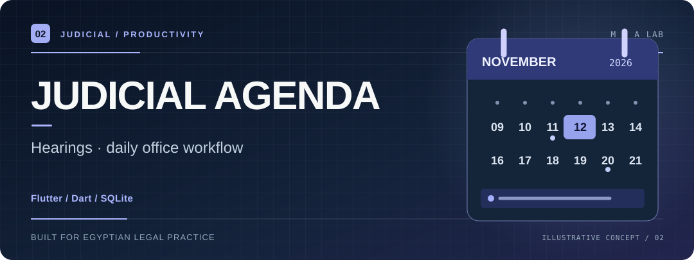
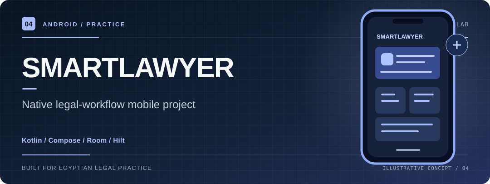
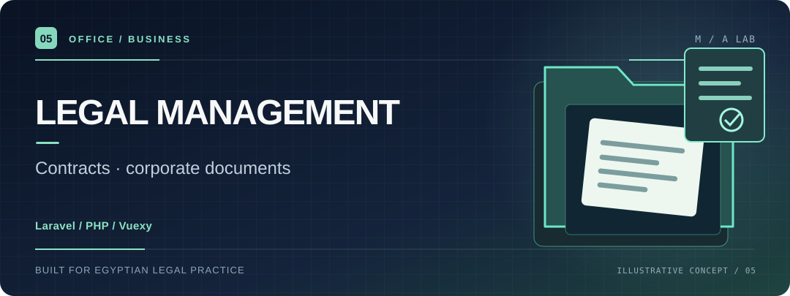
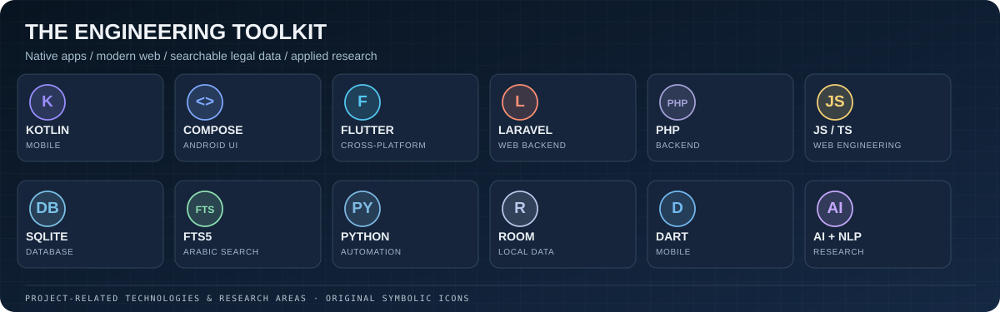
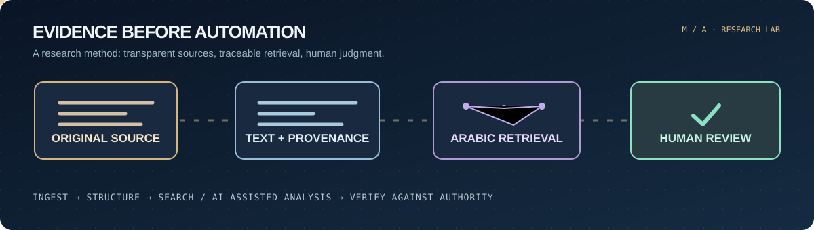

  

  <h1>Mohamed Atef  / محمد عاطف</h1>
  
<strong>Egyptian Lawyer &nbsp;·&nbsp; Legal Tech Developer &nbsp;·&nbsp; Applied AI &amp; Arabic Legal Search</strong>

  
Building purposeful software at the intersection of <b>Egyptian law</b>, <b>search engineering</b> and <b>human-verified AI workflows</b>.

  
من الممارسة القانونية إلى أنظمة بحث وأجندات وأدوات رقمية تخدم المحامي المصري بدقة ووضوح.

  
  
  

---

## 01 / Selected legal-tech projects

Six different problems. Six focused project directions. Each illustration below is an **original project visual**, not a claimed application screenshot.

<table>
  <tr>
    <td width="50%" valign="top">
      
      
 RESEARCH PRODUCT <a href="https://github.com/matef-hub/ahkam-app"><strong>Ahkam · الموسوعة القضائية</strong></a>

      
Egyptian judgments, legal principles and Arabic-aware research with original judgment context.

      
<code>JavaScript</code> &nbsp; <code>Arabic Search</code> &nbsp; <code>Case-law</code>

      
<a href="https://github.com/matef-hub/ahkam-app"><strong>Explore repository ↗</strong></a>

    </td>
    <td width="50%" valign="top">
      
      
 MOBILE APPLICATION <a href="https://github.com/matef-hub/agenda"><strong>Judicial Agenda · الأجندة القضائية</strong></a>

      
A focused Flutter judicial agenda: hearings, powers of attorney, bailiff work and daily tasks.

      
<code>Flutter</code> &nbsp; <code>Dart</code> &nbsp; <code>SQLite</code>

      
<a href="https://github.com/matef-hub/agenda"><strong>Explore repository ↗</strong></a>

    </td>
  </tr>
  <tr>
    <td width="50%" valign="top">
      
      
 LEGAL CALCULATOR <a href="https://github.com/matef-hub/Egyptian-Legal-Deadlines-Calculator"><strong>Egyptian Legal Deadlines</strong></a>

      
Android-first procedural deadline calculations with visible legal sources and verification states.

      
<code>Kotlin</code> &nbsp; <code>Compose</code> &nbsp; <code>Android</code>

      
<a href="https://github.com/matef-hub/Egyptian-Legal-Deadlines-Calculator"><strong>Explore repository ↗</strong></a>

    </td>
    <td width="50%" valign="top">
      
      
 ANDROID PROJECT <a href="https://github.com/matef-hub/SmartLawyer"><strong>SmartLawyer</strong></a>

      
Native Android exploration of client, case and hearing workflows with an Arabic-first interface.

      
<code>Kotlin</code> &nbsp; <code>Room</code> &nbsp; <code>Hilt</code>

      
<a href="https://github.com/matef-hub/SmartLawyer"><strong>Explore repository ↗</strong></a>

    </td>
  </tr>
  <tr>
    <td width="50%" valign="top">
      
      
 LEGAL OPERATIONS <a href="https://github.com/matef-hub/Legal-management-666"><strong>Legal Management System</strong></a>

      
Laravel/Vuexy workspace for company documents, contracts and legal-office operations.

      
<code>Laravel 12</code> &nbsp; <code>PHP</code> &nbsp; <code>Vuexy</code>

      
<a href="https://github.com/matef-hub/Legal-management-666"><strong>Explore repository ↗</strong></a>

    </td>
    <td width="50%" valign="top">
      
      
 RESEARCH LAB <a href="https://github.com/matef-hub/smart-lawyer-ai-training"><strong>Legal AI Research · Arabic NLP</strong></a>

      
Structured Egyptian legal-text materials for retrieval and AI-workflow evaluation — not a validated trained model.

      
<code>Arabic NLP</code> &nbsp; <code>Data provenance</code> &nbsp; <code>Retrieval</code>

      
<a href="https://github.com/matef-hub/smart-lawyer-ai-training"><strong>Explore repository ↗</strong></a>

    </td>
  </tr>
</table>

  Use the project links to inspect actual repository code, scope, development stage and documentation.

---

## 02 / The engineering toolkit

  
   
  

<strong>More about the stack and how it relates to the projects</strong>

| Discipline | Application |
|:--|:--|
| **Mobile engineering** | Kotlin, Jetpack Compose, Room, Hilt, Flutter and Dart |
| **Web and operations** | JavaScript, TypeScript, PHP, Laravel and Vuexy |
| **Data and retrieval** | SQLite / FTS5, structured records, search evaluation and Arabic text normalization |
| **Applied AI** | Source-aware extraction, retrieval experiments, prompt evaluation and human verification |
| **Design** | Arabic RTL interfaces, clear information hierarchy, accessible states and professional workflows |

---

## 03 / Research that begins with evidence

  

<table>
<tr>
<td width="50%" valign="top">
  <h3>⚖️ Egyptian legal research</h3>
  
Judgment discovery, legislative context, judicial principles, verification status and source traceability. The legal document is the authority — not a search snippet.

</td>
<td width="50%" valign="top">
  <h3>🔎 Arabic search engineering</h3>
  
Arabic normalization, source-text preservation, full-text indexing, ranking evaluation and avoiding misleading phrase matches.

</td>
</tr>
<tr>
<td width="50%" valign="top">
  <h3>🤖 Applied AI &amp; legal data</h3>
  
Structured extraction and retrieval-assisted research, with attention to citation quality, provenance, error cases and model evaluation.

</td>
<td width="50%" valign="top">
  <h3>📱 Practice-first design</h3>
  
Hearings, deadlines, documents, client records, Arabic RTL layouts and tools designed around how Egyptian lawyers actually work.

</td>
</tr>
</table>

<strong>Research principles and technical approach</strong>

- Preserve the original legal text, publication details and source links separately from normalized searchable copies.
- Evaluate Arabic retrieval against the original text rather than trusting a single search index or a model answer.
- Distinguish verified sources, candidate extractions, incomplete records and human review outcomes.
- Keep the legal professional in control of legal interpretation and current-law verification.
- Do not claim that a dataset proves a trained model or that a prototype is production-ready.

**Core workflow:** `Original source → Metadata → Arabic search → Relevant context → Human legal verification`

---

## 04 / The person behind the projects

I approach legal software as an Egyptian legal practitioner and a developer. The objective is not to make the interface look technical; it is to make legal information **easier to locate, review and act on**, while keeping the source, limitations and decision points visible.

<strong>هدفي:</strong> بناء حلول تكنولوجيا قانونية تحترم دقة النصوص، وتُبسّط إجراءات العمل، وتستفيد من الذكاء الاصطناعي كأداة مساعدة لا كبديل عن التحقق القانوني.

  <a href="https://github.com/matef-hub?tab=repositories"><strong>ALL REPOSITORIES</strong></a>
  &nbsp; / &nbsp;
  <a href="https://github.com/matef-hub?tab=achievements"><strong>GITHUB ACHIEVEMENTS</strong></a>
  &nbsp; / &nbsp;
  <a href="https://matef-hub.github.io/atefdodo/"><strong>PORTFOLIO</strong></a>
  &nbsp; / &nbsp;
  <a href="https://www.linkedin.com/in/moateflawyer/"><strong>LINKEDIN</strong></a>
  &nbsp; / &nbsp;
  <a href="https://ateflaw.com/"><strong>LEGAL PRACTICE</strong></a>

  
Original vector visual system · Subtle SVG motion · No visitor trackers in the profile source · Project illustrations are conceptual

