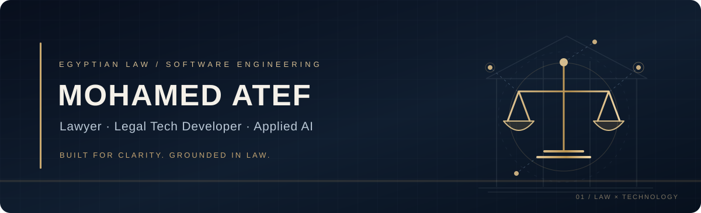
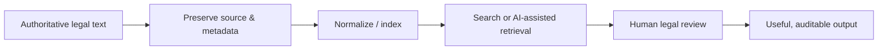

<div align="center">
  

  <br />

  **Egyptian Lawyer · Legal Software Developer · Applied AI & Arabic Legal Search**

  [Legal practice](https://ateflaw.com/) &nbsp;·&nbsp; [LinkedIn](https://www.linkedin.com/in/moateflawyer/) &nbsp;·&nbsp; [GitHub](https://github.com/matef-hub) &nbsp;·&nbsp; [Ahkam](https://ahkam.app/)

  <sub>القانون المصري × هندسة البرمجيات × الذكاء الاصطناعي التطبيقي</sub>
</div>

**[Explore the interactive portfolio source](https://github.com/matef-hub/atefdodo/tree/main/docs)** · **[Explore all repositories](https://github.com/matef-hub?tab=repositories)**

## The intersection of law and software

I'm **Mohamed Atef**, an Egyptian lawyer who builds tools for real legal workflows: finding case law, organizing hearings, managing matters, and calculating procedural deadlines. My approach starts with the legal problem, then chooses the right data model, interface and engineering tools.

أعمل على تطوير أدوات عربية مخصصة للممارسة القانونية المصرية؛ هدفها تسهيل الوصول للمعلومة القانونية وتنظيم العمل مع الحفاظ على دقة المصدر، ووضوح الحالات التي تحتاج إلى مراجعة بشرية.


## Selected legal-tech work

| Research & knowledge | Practice & workflow |
|:--|:--|
| **[Ahkam — الموسوعة القضائية](https://github.com/matef-hub/ahkam-app)**<br/>Research interface for Egyptian judgments and legal principles, with Arabic-aware search. [Project site](https://ahkam.app/) | **[Judicial Agenda — الأجندة القضائية](https://github.com/matef-hub/agenda)**<br/>A focused Arabic Flutter agenda for hearings, powers of attorney, bailiff work and office tasks. |
| **[Egyptian Legal Deadlines Calculator](https://github.com/matef-hub/Egyptian-Legal-Deadlines-Calculator)**<br/>Android-focused statutory deadline calculation; legal references and exceptional situations require verification. | **[SmartLawyer](https://github.com/matef-hub/SmartLawyer)**<br/>Native Android exploration of client, matter and hearing management with Kotlin and Compose. |
| **[Legal AI training research](https://github.com/matef-hub/smart-lawyer-ai-training)**<br/>Structured Egyptian legal text experiments for retrieval and model evaluation; not a substitute for authoritative sources. | **[Legal Management System](https://github.com/matef-hub/Legal-management-666)**<br/>Laravel/Vuexy workflow for matters, hearings, corporate documents and related office operations. |

> Projects differ in maturity. Repository documentation describes the source available there; a screenshot, public repository or demo does not imply a production-ready service.

## Engineering focus

```text
Egyptian legal sources → structured records → validation & provenance
                       → Arabic search / retrieval
                       → human-reviewed legal workflows
```

- **Law & research:** Egyptian case law, legal procedure, statutory deadlines, document workflows and citation provenance.
- **Software:** Kotlin / Jetpack Compose / Room, Flutter / Dart, Laravel / PHP, JavaScript / TypeScript and Python.
- **Data & search:** SQLite / FTS5, PostgreSQL, search indexing, Arabic orthographic normalization and relevance evaluation.
- **AI application:** retrieval-augmented workflows, structured extraction, verification, prompt and model evaluation.

## How I build



I prefer traceable source documents, small testable changes, clear Arabic UX, data minimization and honest release notes. **AI can assist legal research; it cannot replace checking the current law or the full underlying judgment.**

## Connect

For professional collaboration in **Egyptian legal technology**, connect on [LinkedIn](https://www.linkedin.com/in/moateflawyer/) or explore [ateflaw.com](https://ateflaw.com/).

<sub>Design direction: the court docket meets the engineering blueprint. Original SVG illustrations, restrained motion, and no third-party visitor trackers.</sub>
